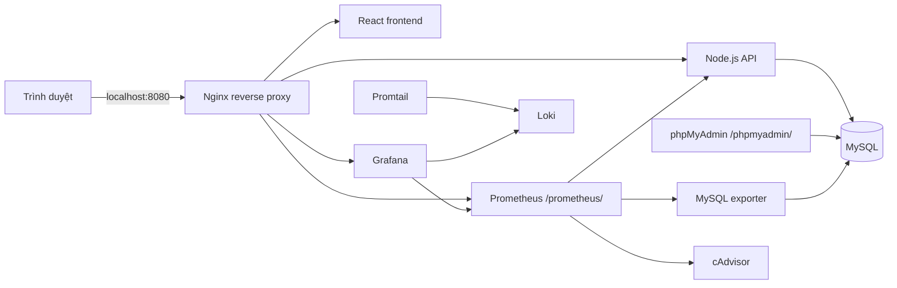

# Đề tài 13 — Website Portfolio và giám sát hạ tầng

Project học phần **Triển khai và Quản trị Hệ thống Phần mềm**. Hệ thống gồm website React, API Node.js, MySQL, phpMyAdmin, Nginx reverse proxy, Prometheus, Grafana, Loki, Promtail, MySQL exporter và cAdvisor; tất cả chạy bằng Docker Compose.

## Thông tin sinh viên

- Sinh viên: **Sùng A Dà**
- Ngành: **Công nghệ thông tin**, sinh viên năm 3
- Trường: **Trường Đại học Công nghệ Thông tin và Truyền thông Thái Nguyên**
- Email: **sungda481@gmail.com**
- Mã số sinh viên/lớp: điền chính xác theo hồ sơ trước khi nộp.
- GitHub: [dtc245200607-alt/Du-an-ca-nhan](https://github.com/dtc245200607-alt/Du-an-ca-nhan)

## Chạy dự án

Cài Docker Desktop, mở terminal tại thư mục `de13-portfolio` và chạy:

```powershell
if (!(Test-Path .env)) { Copy-Item .env.example .env }
code .env
docker compose config
docker compose up -d --build
docker compose ps
```

Ở lần cài mới, thay `CHANGE_ME_TO_A_STRONG_PASSWORD` trong `.env` bằng mật khẩu root MySQL mạnh trước khi chạy. Không đưa `.env` lên GitHub. Nếu tái dùng volume cũ, giữ đúng mật khẩu root đã khởi tạo volume hoặc đổi mật khẩu trong MySQL trước khi thay giá trị này.

Mở website tại <http://localhost:8080>. Nginx là cổng duy nhất; phpMyAdmin và Prometheus cũng được truy cập qua các đường dẫn Nginx, không mở cổng riêng. MySQL, backend, exporter và Loki không publish cổng trực tiếp ra host.

> Chỉ tạo `.env` nếu chưa có. `docker-compose.yml` yêu cầu biến `MYSQL_ROOT_PASSWORD` trong `.env` và không chứa mật khẩu root mặc định. Mật khẩu ứng dụng và exporter được dịch vụ `mysql-accounts` đồng bộ khi stack khởi động. Không chạy `docker compose down -v` nếu cần giữ dữ liệu.

## Các trang và tài khoản demo

| Thành phần | Địa chỉ | Đăng nhập / ghi chú |
| --- | --- | --- |
| Portfolio qua Nginx | <http://localhost:8080> | React + Nginx reverse proxy |
| API health | <http://localhost:8080/api/health> | `status: ok`, `database: connected` |
| phpMyAdmin | <http://localhost:8080/phpmyadmin/> | Server `mysql`, database `portfolio`, user `portfolio_app` |
| Prometheus | <http://localhost:8080/prometheus/targets> | Các job API, MySQL và cAdvisor |
| Grafana | <http://localhost:8080/grafana/> | User `admin`; mật khẩu từ `GRAFANA_PASSWORD` trong `.env` |
| LogQL | Grafana → Explore → Loki | Chạy các truy vấn ở mục Logging bên dưới |

Tài khoản quản trị portfolio: `admin@demo.vn` / `123456@`. Tài khoản demo `editor@demo.vn` và `viewer@demo.vn` cũng dùng mật khẩu `123456@`. Thay thông tin demo trước khi chia sẻ trên mạng công khai.

Trong phpMyAdmin, đăng nhập bằng `portfolio_app` và `MYSQL_PASSWORD` trong `.env`. Các bảng chính: `users`, `projects`, `messages`, `portfolio_content`.

## Kiến trúc và mạng

- `edge`: Nginx, frontend, Grafana và backend; Nginx chuyển tiếp website, `/api/`, `/metrics`, `/grafana/`, `/phpmyadmin/` và `/prometheus/`.
- `data` (internal): MySQL, backend, phpMyAdmin, exporter và job cấp tài khoản một lần.
- `monitoring` (internal): Prometheus, Grafana, Loki, Promtail, cAdvisor, backend và MySQL exporter.
- `db_admin` và `metrics_proxy` (internal): các network riêng chỉ nối Nginx với phpMyAdmin và Prometheus tương ứng.
- MySQL dùng named volume `de13-portfolio_mysql_data_v2`; Prometheus, Grafana và Loki có volume riêng.
- Chỉ Nginx publish cổng `127.0.0.1:8080`; các giao diện quản trị đi qua Nginx và không publish cổng riêng.



## Monitoring và Dashboard

Prometheus scrape mỗi 15 giây. Job `portfolio-api` lấy request/runtime metrics từ backend; `mysql` lấy database metrics qua exporter; `containers` lấy CPU/bộ nhớ container từ cAdvisor. Dashboard **Portfolio Demo Overview** được provision sẵn với request rate, CPU, memory, backend uptime, MySQL availability và số kết nối MySQL.

Tạo một vài lượt tải trang hoặc gọi API, đợi 1–2 phút rồi xem dashboard. Trong Prometheus, các target mong đợi ở trạng thái **UP**: `prometheus`, `portfolio-api`, `mysql`, `containers`.

## Logging và truy vấn LogQL

Backend ghi JSON log vào stdout. Promtail khám phá Docker container, gắn nhãn `service` và gửi log đến Loki. Chọn datasource Loki trong Grafana Explore, chọn khoảng thời gian gần nhất, rồi thử:

```logql
{service="backend"}
```

```logql
{service="backend"} |= "http_request"
```

```logql
{service="backend"} | json | status >= 500
```

Truy vấn thứ ba chỉ trả kết quả khi có request lỗi 5xx. Các lỗi 4xx do nhập liệu hoặc thiếu quyền không phải lỗi máy chủ. Promtail cần đọc Docker socket; chỉ chạy cấu hình này trên máy lab tin cậy.

## Hardening đã cấu hình

- Nginx và backend dùng image non-root; frontend chạy bằng user `nginx`.
- Nginx/backend filesystem read-only, `/tmp` tạm, `no-new-privileges` và bỏ Linux capabilities.
- Prometheus, Grafana, Loki và Promtail cũng dùng filesystem read-only, `no-new-privileges`, bỏ capabilities; dữ liệu cần giữ nằm trên named volumes.
- MySQL không publish cổng host; tách mạng `data` và `monitoring` dạng internal.
- Tài khoản backend riêng chỉ nhận quyền trên database portfolio; user exporter chỉ có `PROCESS`, `REPLICATION CLIENT`, `SELECT`.
- Nginx áp dụng CSP, `X-Content-Type-Options`, `X-Frame-Options`, `Referrer-Policy`, `Permissions-Policy`.
- Grafana tắt tự đăng ký tài khoản; trang quản trị DB và Prometheus không publish cổng riêng, chỉ đi qua Nginx vốn bind loopback.
- `.env` nằm trong `.gitignore`; `.env.example` chỉ chứa thông tin demo cần thay.

cAdvisor chạy privileged và đọc mount host để lấy số liệu container; Promtail cần Docker socket. Đây là các ngoại lệ quan sát có quyền host cao hơn container ứng dụng; không triển khai stack lab lên Internet nguyên trạng. HTTP được dùng trong localhost; yêu cầu security headers của đề bài được đáp ứng, chưa cấu hình HTTPS.

## GitHub và ba mốc commit

Không commit `.env`, mật khẩu thật, cache, `node_modules` hoặc dữ liệu database. Trước khi push, xác nhận đúng mã số sinh viên và tên repository theo yêu cầu giảng viên. Ba commit cần thể hiện lần lượt:

1. `feat: deploy portfolio app with MySQL and Nginx proxy`
2. `feat: add Prometheus Grafana monitoring and hardening`
3. `feat: add Loki logging and project report`

Kiểm tra bằng `git log --oneline -3` và `git status --short`. Repository: [dtc245200607-alt/Du-an-ca-nhan](https://github.com/dtc245200607-alt/Du-an-ca-nhan).

## Kiểm tra và xử lý sự cố

```powershell
docker compose ps
docker compose logs --tail 100 backend mysql mysql-accounts mysql-exporter
docker compose config
```

- Nếu Docker báo không kết nối engine, mở Docker Desktop và đợi trạng thái **Running**.
- Nếu website không mở, xem `nginx` và `frontend`; cổng web là `8080`.
- Nếu API không kết nối MySQL, xem `mysql` trước, rồi kiểm tra log `mysql-accounts` và biến `MYSQL_ROOT_PASSWORD`.
- Nếu `mysql-exporter` không lên, kiểm tra `MYSQL_EXPORTER_PASSWORD` đồng nhất giữa `.env` và Compose, rồi xem target MySQL trên `/targets`.
- Nếu Loki không có log, kiểm tra Promtail và quyền Docker socket; tạo request mới rồi chạy lại LogQL.
- Dừng dịch vụ nhưng giữ dữ liệu: `docker compose down`. Lệnh `docker compose down -v` xóa các volume và dữ liệu.

## Tài liệu báo cáo

Báo cáo tổng hợp ở [`report/Bao-cao-De-13.docx`](report/Bao-cao-De-13.docx). Trước khi nộp, hoàn thiện mã số sinh viên/lớp/giảng viên trên bìa và chèn ảnh chụp thật từ máy chạy demo: website, phpMyAdmin, Prometheus Targets, dashboard Grafana, LogQL, `docker compose ps`, cấu hình Nginx/security headers và repository với ba commit. Không dùng ảnh giả làm bằng chứng chạy dịch vụ.
